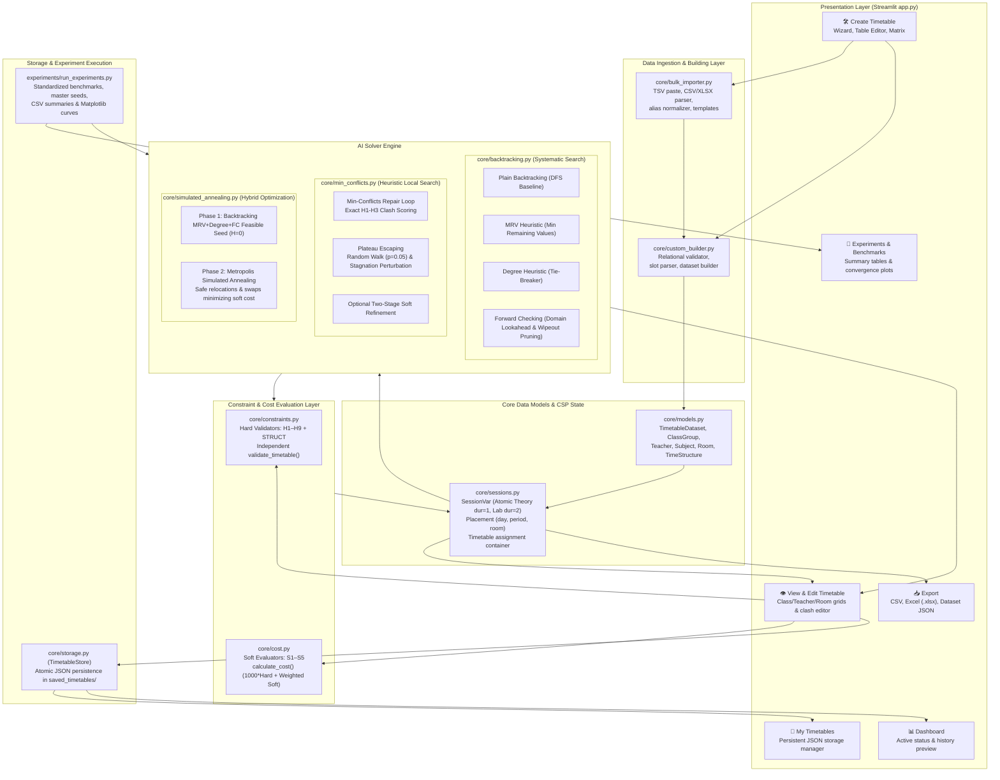
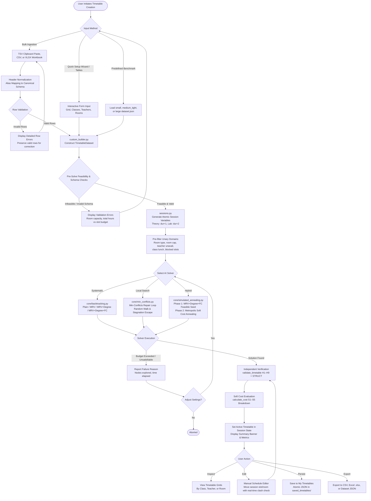
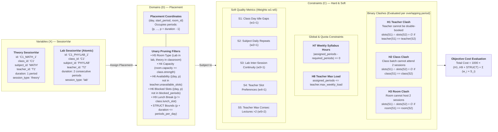
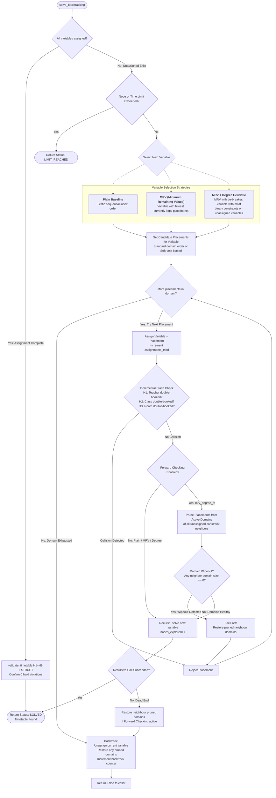
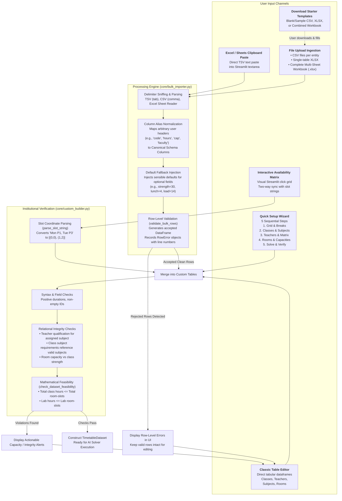

# Technical Architecture & Algorithm Diagrams

This directory contains technical diagrams illustrating the architecture, workflows, CSP modeling, search algorithms, and constraint evaluation mechanisms implemented in the **AI-Based Timetable Scheduler**.

Each diagram is provided as a standalone [Mermaid](https://mermaid.js.org/) source file (`.mmd`) and rendered below for review on GitHub.

---

## Diagram Index

1. [Diagram A: System Architecture](#diagram-a-system-architecture) (`system_architecture.mmd`)
2. [Diagram B: Timetable Generation Workflow](#diagram-b-timetable-generation-workflow) (`timetable_generation_workflow.mmd`)
3. [Diagram C: CSP Problem Formulation](#diagram-c-csp-problem-formulation) (`csp_formulation.mmd`)
4. [Diagram D: Systematic Backtracking CSP Solvers](#diagram-d-systematic-backtracking-csp-solvers) (`backtracking_csp.mmd`)
5. [Diagram E: Min-Conflicts Local Search](#diagram-e-min-conflicts-local-search) (`min_conflicts_algorithm.mmd`)
6. [Diagram F: Hard & Soft Constraint Evaluation](#diagram-f-hard--soft-constraint-evaluation) (`constraint_evaluation.mmd`)
7. [Diagram G: Data Import & Custom Timetable Setup](#diagram-g-data-import--custom-timetable-setup) (`data_import_setup.mmd`)

---

### Diagram A: System Architecture

Source: [`system_architecture.mmd`](system_architecture.mmd)



---

### Diagram B: Timetable Generation Workflow

Source: [`timetable_generation_workflow.mmd`](timetable_generation_workflow.mmd)



---

### Diagram C: CSP Problem Formulation

Source: [`csp_formulation.mmd`](csp_formulation.mmd)



---

### Diagram D: Systematic Backtracking CSP Solvers

Source: [`backtracking_csp.mmd`](backtracking_csp.mmd)



---

### Diagram E: Min-Conflicts Local Search

Source: [`min_conflicts_algorithm.mmd`](min_conflicts_algorithm.mmd)

```mermaid
flowchart TD
    START([solve_min_conflicts]) --> INIT[Generate Complete Initial Assignment<br/>Random or Greedy from valid unary domains]
    INIT --> CHECK_DOM{Any variable has empty domain?}
    CHECK_DOM -->|Yes| UNSAT([Return Status: UNSATISFIABLE])

    CHECK_DOM -->|No: Valid Complete State| ASSESS[Assess Binary Conflicts for all variables<br/>H1 Teacher, H2 Class, H3 Room Clashes]

    ASSESS --> CONF_CHECK{Conflicted Variables Count == 0?}
    CONF_CHECK -->|Yes: 0 Hard Conflicts| INDEP_VAL[Independent Verification<br/>validate_timetable H1–H9 + STRUCT]
    
    INDEP_VAL --> TWO_STAGE{Two-Stage Soft Refinement Enabled?}
    TWO_STAGE -->|No| SOLVED([Return Status: SOLVED<br/>Conflict-Free Timetable])
    TWO_STAGE -->|Yes| SOFT_REFINE[Execute Local Moves Strictly Preserving 0 Hard Clashes<br/>Minimizing S1–S5 Soft Penalty Breakdown] --> SOLVED

    CONF_CHECK -->|No: Conflicts Exist| ITER_CHECK{Iteration Limit (5000)<br/>or Time Limit Exceeded?}
    ITER_CHECK -->|Yes| LIMIT([Return Status: LIMIT_REACHED<br/>Return Best Timetable Found])

    ITER_CHECK -->|No: Search Continues| STAGNATION{Stagnation Check:<br/>Global min conflict unimproved for 150 steps?}
    STAGNATION -->|Yes: Plateau Trapped| PERTURB[Force Random Perturbation on a Conflicted Variable<br/>Reset Stagnation Counter] --> EVAL_NEXT
    
    STAGNATION -->|No: Progress Normal| EVAL_NEXT[Select Conflicted Variable V<br/>Randomly from variables with conflict > 0]

    EVAL_NEXT --> WALK_CHECK{Random Walk Check?<br/>p < random_walk_probability (0.05)}
    
    WALK_CHECK -->|Yes: Explore| CHOOSE_RANDOM[Pick Random Legal Placement from Domain(V)] --> APPLY_MOVE
    
    WALK_CHECK -->|No: Greedy Min-Conflict| EVAL_ALL[Score All Candidate Placements in Domain(V)<br/>Count hypothetical H1–H3 collisions with other variables<br/>Self-exclusion: exclude V from conflict count]
    
    EVAL_ALL --> TIE_BREAK{Identify Placements with Min Conflict Score<br/>Apply Non-Stationary Tie-Breaking}
    TIE_BREAK -->|Ties Exist| PREFER_ALT[Prefer Moving to Alternative Placement<br/>over staying stationary in current slot] --> APPLY_MOVE
    TIE_BREAK -->|Unique Min| CHOOSE_MIN[Select Minimum-Conflict Placement] --> APPLY_MOVE

    APPLY_MOVE[Reassign Variable V = Chosen Placement<br/>iterations++, update cost history] --> ASSESS
```

---

### Diagram F: Hard & Soft Constraint Evaluation

Source: [`constraint_evaluation.mmd`](constraint_evaluation.mmd)

```mermaid
flowchart TD
    TIMETABLE[Timetable State: Placed Sessions & Unassigned Variables] --> SPLIT{Constraint Evaluation}

    subgraph HARD_TIER ["Hard Constraints (H1–H9 + STRUCT) — Feasibility Boundary"]
        direction TB
        H1["<b>H1 Teacher Clash</b>: 1 per conflicting pair of sessions per overlapping period"]
        H2["<b>H2 Class Clash</b>: 1 per conflicting pair of sessions per overlapping period"]
        H3["<b>H3 Room Clash</b>: 1 per conflicting pair of sessions per overlapping period"]
        H4["<b>H4 Room Capacity</b>: 1 per session where room.capacity < class.strength"]
        H5["<b>H5 Room Type</b>: 1 per session in incompatible room (theory in lab / lab in classroom)"]
        H6["<b>H6 Availability & Blocked</b>: 1 per occupied slot on teacher unavailable or global blocked slot"]
        H7["<b>H7 Weekly Syllabus Hours</b>: |assigned_periods - required_periods| per (class, subject)<br/><i>Unassigned sessions automatically count as missing periods!</i>"]
        H8["<b>H8 Teacher Max Load</b>: max(0, assigned_periods - teacher.max_weekly_load) per teacher"]
        H9["<b>H9 Class Lunch Break</b>: 1 per occupied slot overlapping class.lunch_slot"]
        STRUCT["<b>STRUCT Structural Validity</b>: 1 per out-of-bounds slot, overflow period, or invalid teacher-subject assignment"]

        HARD_SUM["Sum Total Hard Violations<br/><code>hard_violation_count</code>"]
        H1 --> HARD_SUM
        H2 --> HARD_SUM
        H3 --> HARD_SUM
        H4 --> HARD_SUM
        H5 --> HARD_SUM
        H6 --> HARD_SUM
        H7 --> HARD_SUM
        H8 --> HARD_SUM
        H9 --> HARD_SUM
        STRUCT --> HARD_SUM
        HARD_PENALTY["<b>Hard Penalty Cost</b><br/><code>1000 × hard_violation_count</code><br/><i>Dominates cost function ensuring feasible > infeasible</i>"]
        HARD_SUM --> HARD_PENALTY
    end

    subgraph SOFT_TIER ["Soft Constraints (S1–S5) — Pedagogical Quality Metrics"]
        direction TB
        S1["<b>S1 Class Daily Gaps</b> (w1 = 1.0)<br/>Idle periods between first and last lecture of class-day<br/><i>Excludes designated lunch break & blocked periods</i>"]
        S2["<b>S2 Subject Daily Spreading</b> (w2 = 1.0)<br/>Penalizes (count - 1) for duplicate theory lectures on same day<br/><i>Atomic lab sessions are strictly exempt</i>"]
        S3["<b>S3 Consecutive Labs Continuity</b> (w3 = 1.0)<br/>Atomic lab periods are consecutive by design;<br/>penalizes disjoint gap periods between separate lab blocks of same subject on same day"]
        S4["<b>S4 Teacher Slot Preferences</b> (w4 = 1.0)<br/>1 penalty per occupied period outside teacher's preferred_slots<br/><i>0 penalty if teacher specified no preferences</i>"]
        S5["<b>S5 Teacher Consecutive Hours</b> (w5 = 2.0)<br/>Penalizes runs of >2 consecutive teaching periods on same day<br/>Penalty = (streak_length - 2) × w5. Lunch/idle breaks streak."]

        SOFT_SUM["<b>Weighted Soft Cost</b><br/><code>w1·S1 + w2·S2 + w3·S3 + w4·S4 + w5·S5</code>"]
        S1 --> SOFT_SUM
        S2 --> SOFT_SUM
        S3 --> SOFT_SUM
        S4 --> SOFT_SUM
        S5 --> SOFT_SUM
    end

    SPLIT --> HARD_TIER
    SPLIT --> SOFT_TIER

    HARD_PENALTY --> TOTAL_COST["<b>Total Objective Cost</b><br/><code>total_cost = hard_cost + total_soft_cost</code><br/>Lower cost = Higher Timetable Quality"]
    SOFT_SUM --> TOTAL_COST

    TOTAL_COST --> STATUS_OUT["<b>Solution Status</b><br/>• is_valid: True iff complete & hard_violations == 0<br/>• is_complete: True iff 0 unassigned sessions"]
```



---

### Diagram G: Data Import & Custom Timetable Setup

Source: [`data_import_setup.mmd`](data_import_setup.mmd)


